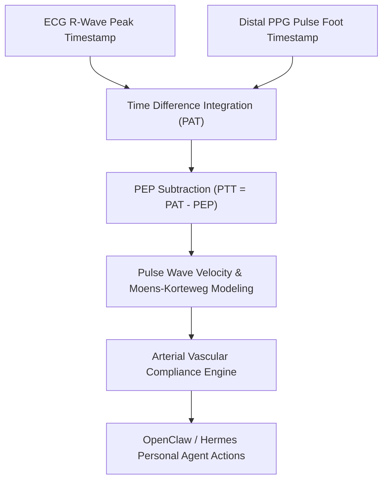

# Dual-Sensor Pulse Arrival Time (PAT / PTT) Skill

[](LICENSE)
[](https://www.python.org/)
[](requirements.txt)
[](mcp_server.py)
[](SKILL.md)

Zero-dependency sovereign personal agent skill for non-invasive evaluation of dual-sensor Pulse Arrival Time (PAT), Pulse Transit Time (PTT), pulse wave velocity (PWV), and arterial elasticity.



## Features
- **Deterministic Math**: Pure Python standard library implementation with zero external dependencies.
- **Hemodynamic Moens-Korteweg Principles**: Implements validated equations linking pulse wave transit to arterial wall stiffness.
- **Continuous Cuffless Cardiovascular Monitoring**: Enables continuous beat-to-beat vascular tone assessment.
- **Model Context Protocol (MCP)**: Native JSON-RPC tool integration for LLMs and autonomous agents.

## Quickstart

```python
from client import PulseArrivalTimeClient

client = PulseArrivalTimeClient()
result = client.evaluate_pulse_transit(
    pat_ms=215.0,
    pre_ejection_period_ms=85.0,
    arterial_path_length_m=0.82
)
print("Pulse Wave Velocity:", result["pulse_wave_velocity_pwv_m_s"], "m/s")
print("Classification:", result["classification"])
```

## License
Apache-2.0
